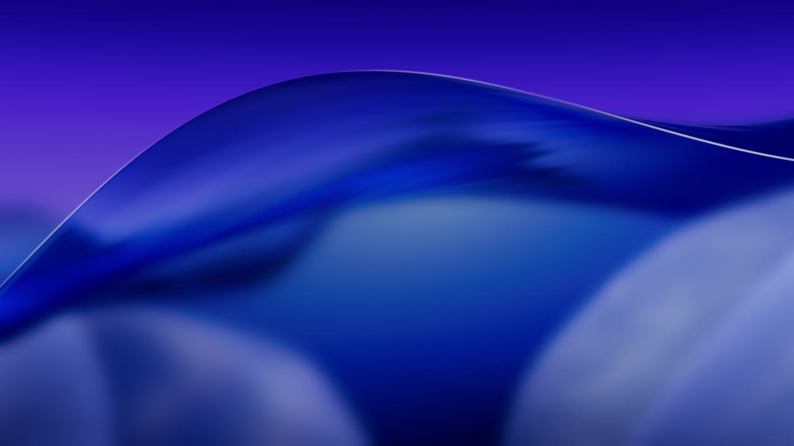
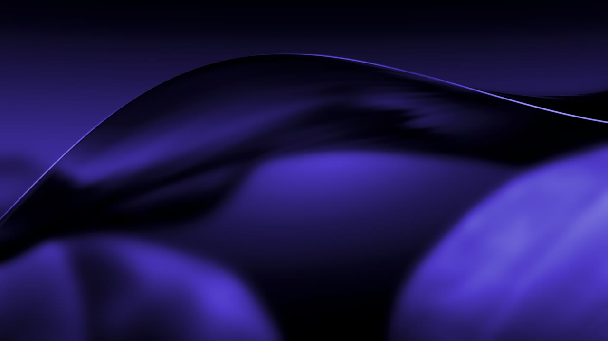
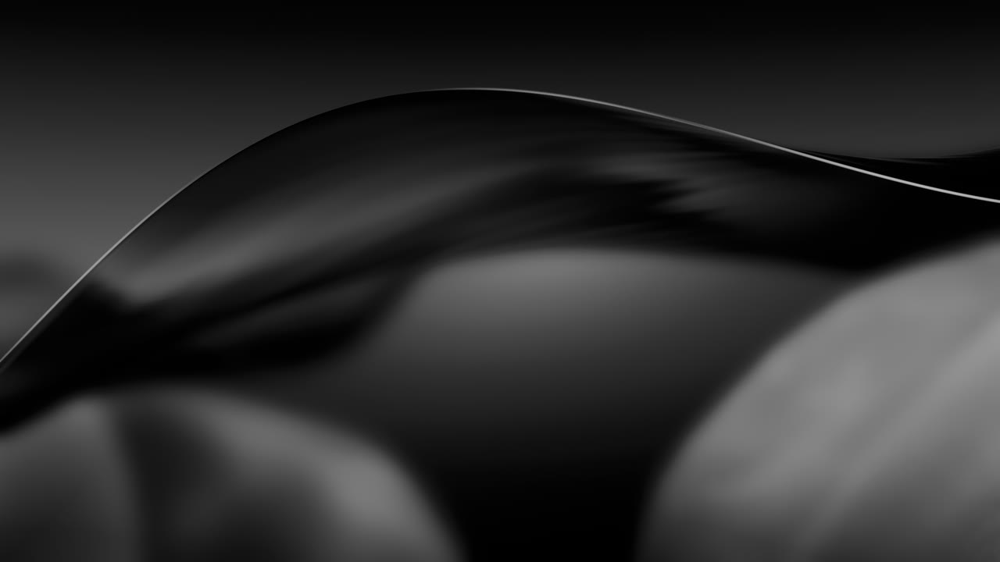
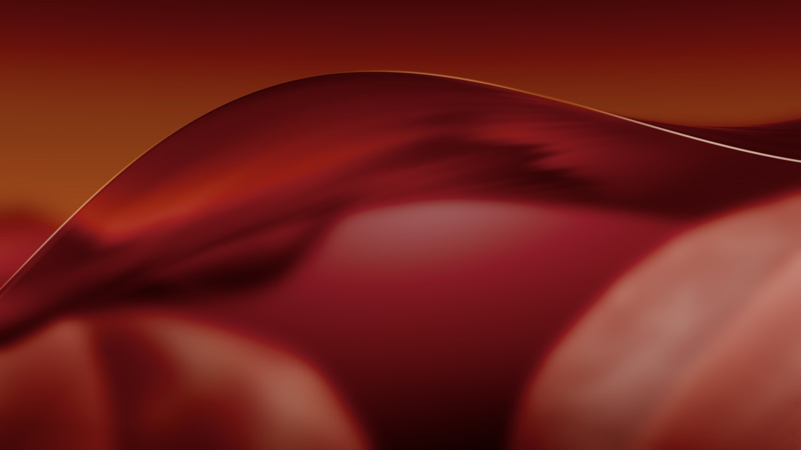
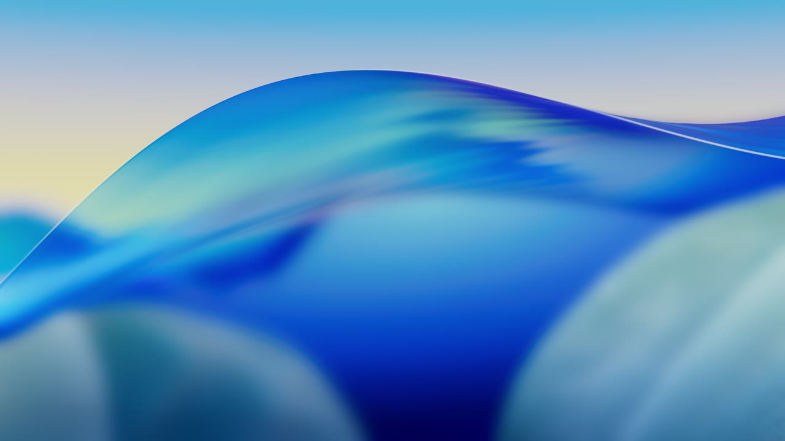
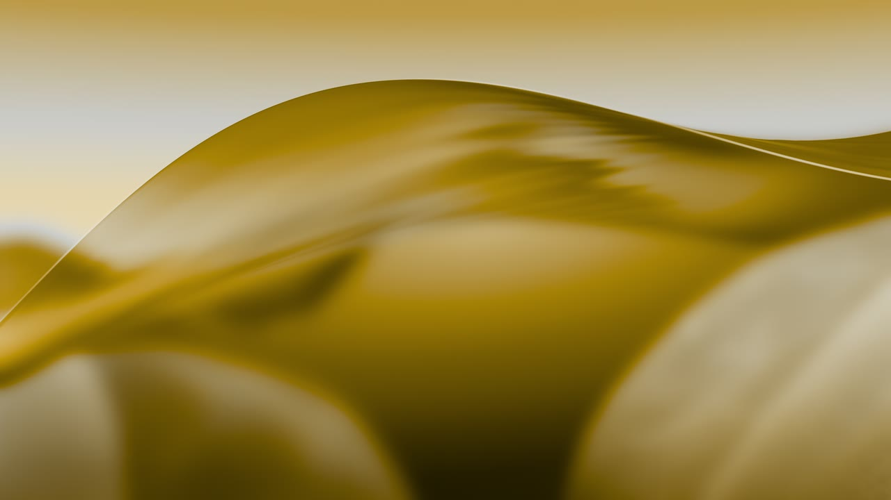

# concratas

Recolor the animated macOS Tahoe wallpaper without the banding and jagged edges you get from a plain hue shift.

Needs macOS 26 with a Tahoe Landscape or Portrait wallpaper selected, Swift (Xcode or the Command Line Tools), and ffmpeg with libx265 (`brew install ffmpeg`). No Apple wallpaper files are included; the script works on the copies already on your Mac.

| | |
| --- | --- |
|  Dark, original |  `#5755d9` |
|  `#808080` |  `120` |
|  Light, original |  `#f7be1c` |

All frames are from the same moment of the video. The `120` example is a single frame recolored through `recolor.swift`; the others are from full renders.

## Quick start

```bash
./tahoe.sh make "#5755d9" "Dark Landscape"
./tahoe.sh set "$HOME/Pictures/Tahoe-custom/Tahoe Dark Landscape - #5755d9.mov" "Dark Landscape"
```

Rendering a full 60-second video takes about 15 minutes and uses every core.

| Command | What it does |
| --- | --- |
| `./tahoe.sh list` | Show the installed variants and your renders |
| `./tahoe.sh make <color> <variant> [pivot]` | Render a recolored variant into `~/Pictures/Tahoe-custom` |
| `./tahoe.sh set <file.mov> <variant>` | Install a video as that variant and reload the wallpaper |
| `./tahoe.sh restore [variant]` | Put Apple's originals back (all four if no variant is given) |

- `variant` is one of `"Dark Landscape"`, `"Light Landscape"`, `"Dark Portrait"`, `"Light Portrait"`. macOS picks Dark or Light from the appearance setting.
- `color` is either degrees (e.g. `90`), which rotates every hue, or `#rrggbb`, which maps brightness from black through that color to white.
- `pivot` (0 to 1, default 0.5) only applies to `#rrggbb`. It picks which source brightness becomes exactly that color; lower makes the result brighter.

The first `make` or `set` copies Apple's videos to `~/Pictures/Tahoe-original-videos`, so `restore` always has them. Make sure no recolored video is installed the first time you run it, or that copy will be the recolor instead of the original.

## How it works

The wallpaper plays these files:

```
~/Library/Containers/com.apple.NeptuneOneExtension/Data/Library/Application Support/Videos/Tahoe <variant>.mov
```

They're user-writable, so installing means copying over them and restarting `NeptuneOneWallpaper` and `WallpaperAgent`. `set` then checks the system log to confirm the new video decoded.

`make` runs three steps:

1. **`recolor.swift`** decodes the original at 10 bits and recolors it in OKLCH through a 3D lookup table. Colors that don't fit lose saturation instead of getting clipped. Hex colors only change brightness, because the color detail in Apple's file is too compressed to recolor cleanly.
2. **x265** encodes it. Apple's own encoder leaves visible steps in the smooth gradients. The settings in `tahoe.sh` (5 temporal layers, 15 B-frames in a pyramid, a keyframe every 5 seconds) let the wallpaper slow down and pause the way Apple's file does.
3. **`remux.swift`** rewraps the result without re-encoding. The wallpaper can't read ffmpeg's `.mov` files and the video disappears when it pauses (`VideoSampleReadingErrors Code=4`). `remux` writes the file with Apple's own writer, sets each frame's timing to exactly 1/240 s, and tags every frame with its temporal layer.

Both Swift scripts also work alone, e.g. for the still `.heic` wallpapers:

```bash
swift recolor.swift <degrees | #rrggbb> <input.mov|.heic> <output.mov|.heic> [pivot]
swift remux.swift <input.mov> <output.mov>
```

Pass `-` as the output of `recolor.swift` to get raw `yuv420p10le` frames on stdout. Both scripts refuse to run when the output is the same file as the input.

## License

MIT, see [LICENSE](LICENSE). The license covers the code only, not Apple's wallpapers or your recolored copies of them.
